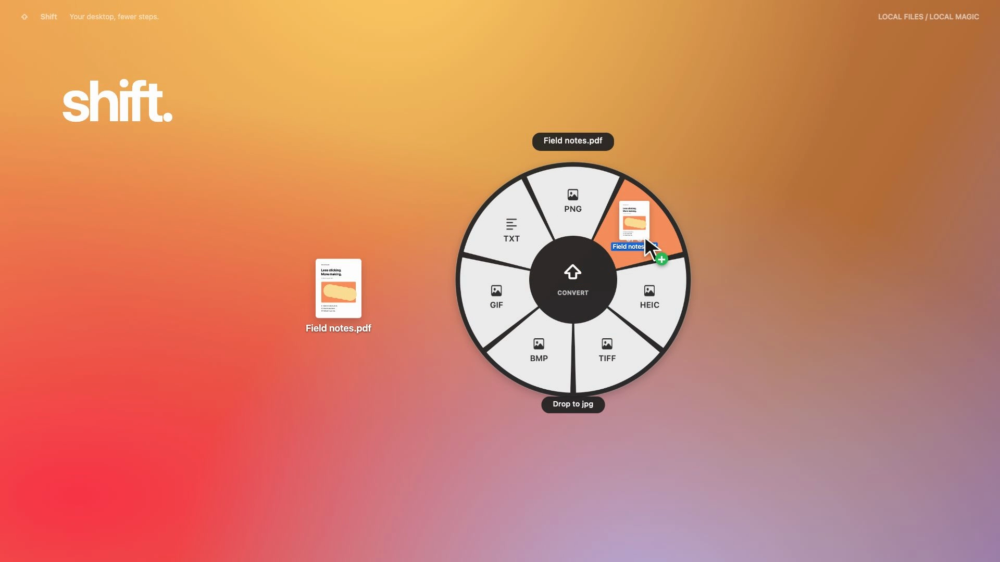

# Shift

**Drag a file. Tap Shift. Drop it onto a format.**

A small, local file converter for macOS. Shift lives in your menu bar and opens a radial menu while you drag an image or PDF. Tap Shift again for crop, background and compression tools.

[Watch the 12 second demo](media/shift-demo.mp4) · [Download the Mac app](https://github.com/RealAdii/shift-convert/releases/latest) · [MIT license](LICENSE)



## Install

Download the ZIP from [Releases](https://github.com/RealAdii/shift-convert/releases/latest), unzip it, and move `Shift.app` to Applications. Open it and leave it running in the menu bar. The prebuilt app is for Apple silicon Macs running macOS 14 or later. Intel users can build from source.

This is an early local build, ad hoc signed and not notarized. macOS may require you to use System Settings > Privacy & Security > Open Anyway after the first launch attempt. Only do this for a build whose source you trust.

## Use

1. Start dragging an image or PDF from Finder or your desktop. Keep the mouse button held.
2. Tap and release Shift. The format wheel opens around your pointer.
3. Move onto a format and release the mouse button.
4. Find the new file beside the original.

Tap Shift again during the drag to switch between formats and editing tools. Press Escape or release outside a sector to dismiss. Shift does not need to stay held.

The main window also accepts dropped files and provides a standard file picker and native controls for keyboard and assistive technology access. The menu bar icon reopens it. Closing the window keeps the shortcut running. Use Quit Shift in the menu bar to exit or pause the shortcut if it conflicts with another app.

## Supported operations

| Input | Outputs and tools |
| --- | --- |
| Images | PNG, JPG, PDF, HEIC, TIFF, BMP and GIF, using the encoders available on your Mac |
| PDFs | Every page to a separate image, with page numbers in the filenames |
| PDFs with selectable text | TXT extraction |
| Images | Crop with aspect ratio, size and position controls |
| Images | Background with color, padding and rounded corners |
| Images and PDFs | Lossy compression |

All processing runs locally. No account, upload, API key or network service is needed. Outputs use numbered filenames when a name already exists. Originals are never overwritten. Batch errors appear in the window, and successful files can be revealed in Finder.

## Build

Requires the Xcode command line tools and Swift 5.9 or later.

```sh
git clone https://github.com/RealAdii/shift-convert.git
cd shift-convert
zsh build.sh
open dist/Shift.app
```

The app has no external package dependencies. It uses AppKit, SwiftUI, PDFKit, Core Graphics, ImageIO and UniformTypeIdentifiers.

## Verify

```sh
.build/release/Shift --self-test
codesign --verify --deep --strict dist/Shift.app
```

The checks generate their own fixtures and verify actual image encoding and decoding, multipage PDF export, PDF text extraction, crop and background output, partial batch errors, filename collisions, original preservation, and every wheel sector and dead zone. CI runs these checks on macOS.

The global Finder drag gesture still needs interactive validation across target Macs and screen configurations. The demo is an animated walkthrough using the native wheel and editor renders plus actual conversion outputs. It is not a continuous screen recording.

## Limits in 0.1.0

- Image inputs normalize orientation and cap the longest side at 8192 pixels.
- Animated GIFs and multipage image files use their first frame.
- PDF rendering uses up to 2x page size and a 3000 pixel longest edge, with a limit of 100 pages and 80 megapixels in total rendered pages.
- PDF compression rasterizes pages. It removes selectable text, links and vector content. Compression can increase the size of an already optimized file.
- Scanned PDFs need OCR, which is not included.
- Metadata is not carried across, and colors normalize to sRGB.
- Video, audio, Office documents, redaction and annotation are not implemented.

## Demo source

The 12 second demo and its original soundtrack are reproducible from [video/](video/README.md). The native app exports its own interface assets with `--demo-assets`. Reference footage and third-party music are not included.

## Contributing

See [CONTRIBUTING.md](CONTRIBUTING.md) for local checks and a manual drag test checklist. Bug reports and small pull requests are welcome.

## License

[MIT](LICENSE). Dependency licenses still apply to the optional video toolchain.
